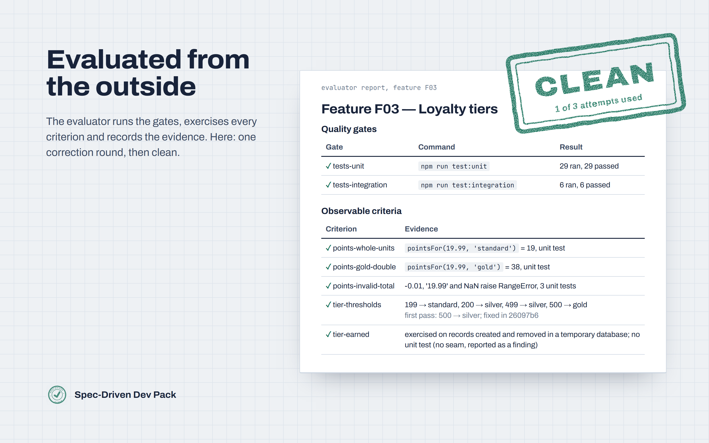

# Spec-Driven Dev Pack: getting started

Sixteen agent skills that take a feature from a PRD to a written contract, an implementation with
its tests, and an external evaluation that sends every failure to the skill that fixes it, until
the feature meets its contract.

This repository holds the documentation only. The skills are sold on
[Agensi](https://www.agensi.io) as the **Spec-Driven Dev Pack**. See it work in a
[77-second replay of a real run](https://youtu.be/xy86flNAlAU).



## How it works

```
SETUP (once per project)
  architecture-analyzer → deep-analyzer → gate-builder    (existing code)
  gate-builder                                            (new project)

PER FEATURE
  prd-writer → spec-writer → implement-feature → evaluator
                                  │                  │ routes each failure:
                                  │ delegates tests  ├─ code → fix-runner
                                  ▼                  └─ test → test-writer → test-validator
                             test-writer
```

- **`spec-writer`** turns your PRD into `spec.md`, `plan.md` and `contract.md`. The contract holds
  the environment, the quality gates and the observable acceptance criteria: it is the single
  definition of done.
- **`implement-feature`** builds the feature phase by phase, one commit per phase, and hands each
  file's tests to the matching test writer.
- **`evaluator`** checks the feature from the outside: it runs the gates, exercises every
  criterion, and does not accept a green test as evidence when that test pins the wrong value.
  Code failures go to `fix-runner`, which makes the minimal fix. Test failures go back to the test
  writer and then to an independent validator. The loop ends at one of three states:

| State | Meaning |
|---|---|
| `CLEAN` | every gate and criterion has evidence; the feature is done |
| `PENDING` | a decision only a person can make, such as approving a gate exception; the report says which |
| `ABORTED` | the attempt limit was reached; the report says what is still failing and why |

## Install

You never download the skills: Agensi serves them to your agent each time it uses one, always in
the latest approved version, and updates are free.

1. Buy the Spec-Driven Dev Pack on [Agensi](https://www.agensi.io).
2. Connect your agent to Agensi's MCP server once:
   - **Claude Code:** `claude mcp add --transport http agensi https://mcp.agensi.io/mcp/auth`, then
     run `/mcp` and choose **Authenticate**.
   - **Codex CLI:** `codex mcp add agensi --url https://mcp.agensi.io/mcp/auth`, then
     `codex mcp login agensi`.
   - **Cursor and other agents with remote MCP:** add `https://mcp.agensi.io/mcp/auth` as a
     Streamable HTTP server and sign in.
3. Check it: ask your agent *"Which Agensi skills do I own?"*

Agensi's own guide: [connecting your agent](https://www.agensi.io/docs/mcp-setup) and
[using a skill](https://www.agensi.io/docs/use-a-skill).

## First run: once per project

Ask your agent, in your project's folder:

- **Existing codebase:** *"Use my Agensi skill architecture-analyzer on this repository"*, then
  *deep-analyzer*, then *gate-builder*.
- **New project:** *"Use my Agensi skill gate-builder"*.

`gate-builder` builds the quality gates (typecheck, lint, build, tests, architecture, dead code,
visual, e2e, whichever fit your stack) and writes `GATES.md`. Every other skill reads your
project's facts from it: where tests live, the runner and commands, the e2e profiles and the data
policy. No skill guesses them.

## Every feature

| Step | Ask your agent | What appears in your repository |
|---|---|---|
| 1 | *"Write the PRD for this product"* (prd-writer) | `docs/PRD.md` |
| 2 | *"Write the spec for feature F01"* (spec-writer) | `docs/F01-<name>/spec.md`, `plan.md`, `contract.md` |
| 3 | *"Implement feature F01"* (implement-feature) | the code and its tests, one commit per phase, `docs/progress.json` |
| 4 | *"Evaluate feature F01"* (evaluator) | the evaluation report, the state in `docs/progress.json`, commits of confirmed tests |

You never call `fix-runner`: the evaluator dispatches it. Each test writer also leaves a checklist
next to the feature (`unit-test.md`, `integration-test.md`, `e2e-test.md`) that records every test,
the run that proved it can fail, and anything the code does that the spec did not define.

## Requirements

- An agent that loads SKILL.md skills and can run shell commands and edit files. The pack is built
  and validated with Claude Code.
- Git, and your project's own toolchain.
- For UI checks and e2e tests: Node.js. The agent installs `playwright-cli` by itself the first time
  a browser step needs it. E2E suites use `@playwright/test`. Back-end-only features never open a
  browser.

## Test suites and languages

| Suite | Languages with their own rules | Runner |
|---|---|---|
| unit | JavaScript/TypeScript, Python, Go, Rust | the one your `GATES.md` declares |
| integration | JavaScript/TypeScript, Python, Go, Rust | the one your `GATES.md` declares |
| e2e | any backend | Playwright (`@playwright/test`) |

Other languages get the generic rules, and the test checklist says so.

## FAQ

**Will it rewrite my codebase?** No. The analyzers are read-only, `fix-runner` changes only what an
evaluation reported, the evaluator never edits code or tests, and every code change lands in a
small commit you can review or revert.

**How is this different from asking my agent to implement and test a feature?** A single agent
grades its own work. Here the acceptance criteria are written down first, a separate evaluator
checks the result against them, and tests are written by one skill and audited by another.

**Which agents does it work with?** It follows the SKILL.md standard. Claude Code is the agent it is
validated with end to end; other agents that load skills by name and run shell commands should
work.

**What if a skill needs a decision from me?** The feature stays `PENDING` and the report names the
decision, for example a gate exception only you can approve. Nothing is guessed on your behalf.

## License

The skills are proprietary and licensed per buyer through Agensi. This repository contains
documentation only.
